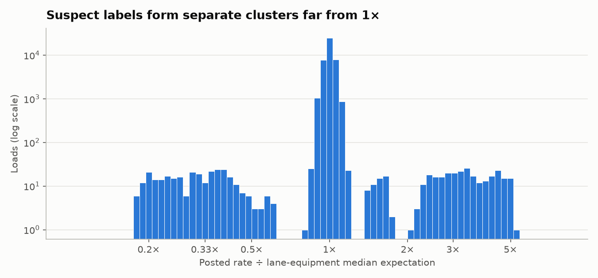
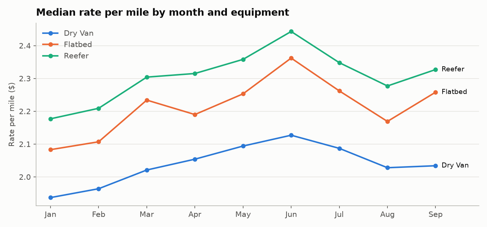
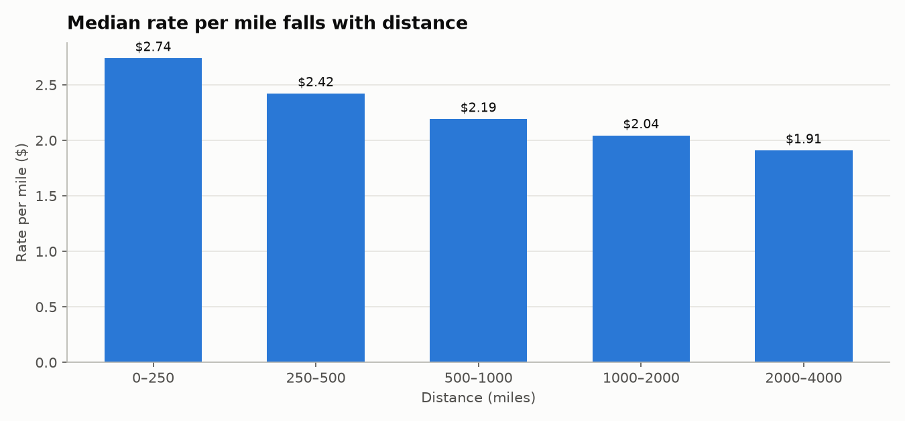
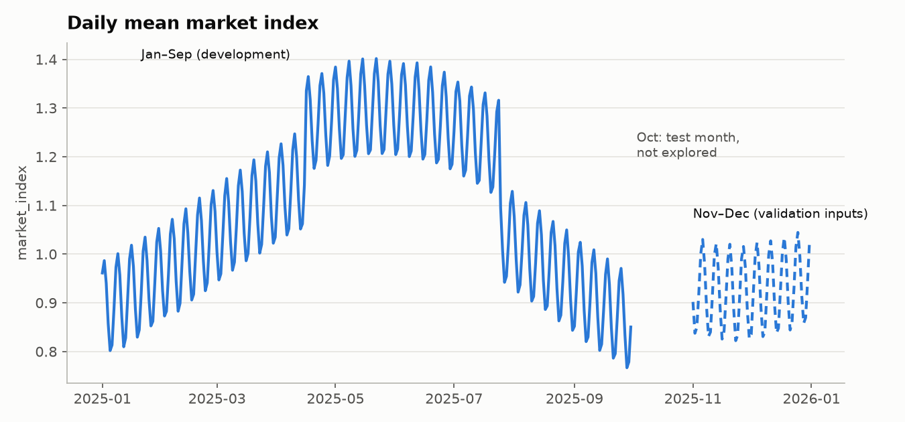

# Step 4 — Data exploration and cleaning

**Code:** [`src/data_preparation.py`](../data_preparation.py)

```bash
poetry run python -m src.data_preparation
```

| Output | Location |
|---|---|
| Cleaned data | `src/data/train_test_clean.csv`, `validation_clean.csv`, `december_chart_inputs_clean.csv` |
| Tables, figures, `summary.json` | `src/outputs/data_preparation/` |

## Scope

- **Exploration** runs on the development months (Jan–Sep) only. October is the test set and is never explored.
- **Cleaning** is deterministic and row-by-row: nothing is learned from the data, so it can be applied to every file (October included) without leakage.
- **Not done here:** imputation, outlier removal, and any target statistic. These are learned from data and belong in each model's pipeline (Step 3).

## Cleaning applied

| Action | Why |
|---|---|
| Strip text columns, parse `date`, validate the schema and equipment values | Fail early on malformed inputs |
| `weight` → absolute value, with a `weight_was_negative` flag | Negative weights are sign errors: their absolute values match the positive distribution (median 31,935 vs 31,492 lb, same 5,000–47,500 range), and their rate per mile is unchanged (2.152 vs 2.143) |
| December inputs completed (see below) | The file lacks features the models need |

### December chart inputs

`december-chart-inputs.csv` has no coordinates, `market_index` or `quote_signal`. They are filled as follows:

- **Coordinates:** looked up from the city table built from the pickup/delivery columns. Every city has exactly one coordinate pair, and both Lexington and Fort Wayne are present.
- **`market_index` and `quote_signal`:** median of the `validation.csv` loads on the same date. These are inputs Spotter provides for Nov–Dec, not labels, so no target information is used. The market index varies by day far more than between loads on the same day (see findings), so the daily median is a faithful value for a single load on that date.

## Data-quality findings (Jan–Sep)

| Issue | Jan–Sep | Nov–Dec (validation) | Treatment |
|---|---|---|---|
| Duplicate IDs / duplicate rows | 0 / 0 | 0 / 0 | None needed |
| Negative `weight` | 259 | 145 | Absolute value (here) |
| Missing `weight` | 268 | 165 | Imputed in model pipelines |
| Missing `market_index` | 332 | 249 | Imputed in model pipelines |
| Missing values by month | Evenly spread (20–44 per month); they almost never co-occur (1 row) | — | Missing at random; a "missing" flag is enough |
| Distance at the 70-mile floor | 37 | 21 | Kept; distances look floored at 70 miles |
| Distance > 2× straight-line distance | 18 | 16 | Kept and flagged; typical road/straight-line ratio is 1.18, so these distances (or coordinates) are suspect |
| Rate per mile < $1 / > $5 | 289 / 279 | — | Handled in model pipelines |
| Labels far from their lane-equipment median (< 0.6× / > 1.8×) | 297 / 266 (1.3%) | — | Handled in model pipelines |

### Corrupted labels



Dividing each posted rate by what its lane and equipment usually pay shows a tight peak at 1× and **separate clusters** away from it: one at about 0.2–0.6×, one at about 2.2–5×, and a smaller group at 1.4–1.7×, with empty gaps in between. Natural price variation would form a continuous tail. Clusters separated by gaps suggest corrupted labels (for example, rates entered on a different basis), affecting about 1.3% of rows.

These rows are kept in the cleaned files. In the model pipelines they will be handled with thresholds learned on training folds only, or with a robust loss. They are never removed from validation or test folds.

> The ratio uses a lane median computed over all of Jan–Sep. It is an exploration tool only and must never be used as a feature or filter outside a training fold.

## Exploration findings (Jan–Sep)

### Equipment and seasonality



- Median rate per mile: **Dry Van $2.04, Flatbed $2.22, Reefer $2.31**. The ordering holds in every month.
- Rates rise from January to a **June peak**, then fall through August. Equipment types move together, so the seasonal effect is market-wide.

### Distance



- Rate per mile **falls with distance**: $2.74 under 250 mi down to $1.91 above 2,000 mi (Spearman −0.73). A single global $/mile underprices short loads and overprices long ones, so distance remains a feature even when modeling rate per mile.

### Market index



- `market_index` is a **daily market-level signal**: the spread between days (std 0.168) is about 7× the spread between loads on the same day (0.025).
- It has a **strong weekly cycle**, peaking on Thursday (1.20) and lowest on Sunday/Monday (1.00), plus a high plateau from mid-April to late July.
- Rates follow it: the daily median rate per mile correlates **0.70** (Spearman) with the daily market index, and rate per mile also peaks midweek ($2.17 Thursday vs $2.13 Monday).
- Nov–Dec market index values (validation inputs) sit around 0.93, similar to September, and keep the weekly cycle. Expect the December chart to show that weekly rhythm.

### Other features

- `quote_signal` varies mostly between loads (within-day std 0.26 vs 0.13 between days); Spearman 0.21 with rate per mile.
- `weight`: Spearman 0.20 with rate per mile.
- Both are weak but not negligible; the models will show whether they add value.

### Coverage

- 64 cities and 4,008 lanes in Jan–Sep.
- **8 validation cities never appear in development data** (Allentown, Charlotte, Chicago, Jackson, Knoxville, Laredo, Norfolk, San Diego), touching **12.1%** of validation rows. Features must generalize beyond city identity: coordinates, distance and fallbacks for lane statistics.

## Implications for Step 5 (models)

1. Model **rate per mile** and keep distance as a feature (rate per mile is not constant in distance).
2. Impute `weight` and `market_index` inside the pipeline, with missing flags.
3. Handle the ~1.3% corrupted labels in training folds only (trimming by learned thresholds, or a robust loss such as Huber / L1).
4. `market_index` and the day of week are the main time signals; month alone cannot carry December, which is never seen in training.
5. Use coordinates and regional fallbacks so unseen cities are still priced sensibly.
