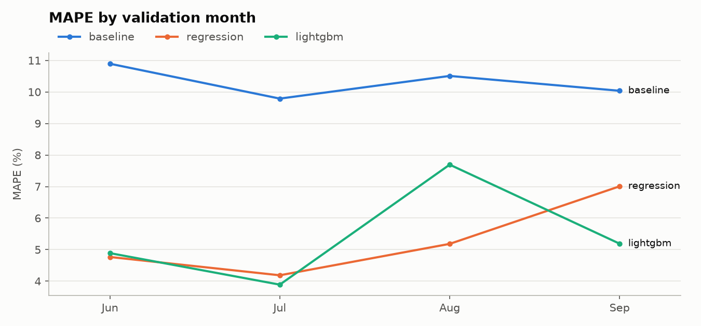
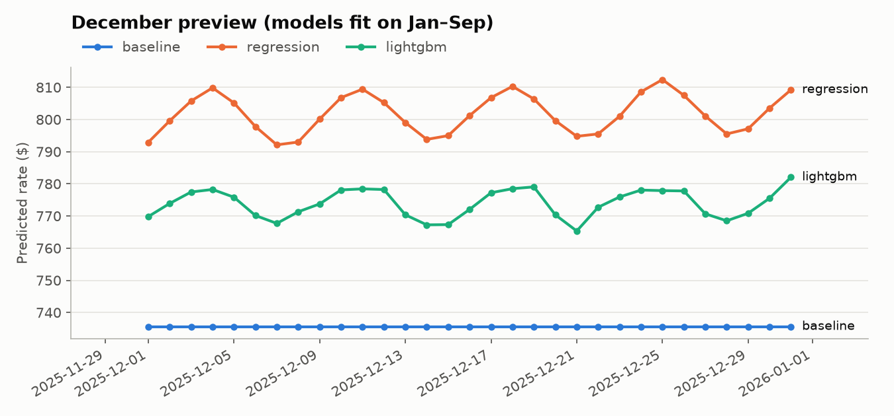

# Step 5 — Models

**Code:** [`src/models/`](../models/) · [`src/train.py`](../train.py) · [`src/features.py`](../features.py)

```bash
poetry run python -m src.train
```

Outputs in `src/outputs/models/`: `cv_folds.csv`, `cv_summary.csv`, `segments.csv`, `lightgbm_feature_importance.csv`, `cv_mape_by_fold.png`, `december_preview.csv/.png`.

## Design

### Shared interface — `src/models/base.py`

Every model is a `RatePerMileModel`:

1. `fit(df)`: optionally drops corrupted labels (filter fit on the rows given, so inside CV it only sees the fold's training months), adds features, and fits on **rate per mile**.
2. `predict(df)`: predicts rate per mile and multiplies by distance, returning dollars.

Each model implements only `_fit` and `_predict`, in its own file.

### Features — `src/features.py` (deterministic, row by row)

| Feature | Why |
|---|---|
| `inverse_distance` (1 / distance) | A load costs roughly a fixed charge plus a per-mile charge, so rate per mile ≈ fixed / distance + per-mile |
| `log_distance` | Smooth distance effect |
| `day_of_week` | Market index and rates peak midweek (Step 4) |
| Raw: `weight`, `market_index`, `quote_signal`, coordinates, `equipment`, `pickup`, `delivery` | — |

Month is **not** a feature: December never appears in training, so a month feature cannot say anything about it.

### Corrupted-label filter — `src/models/label_filter.py`

Learns the median rate per mile per **equipment × distance band** on the training rows, and drops rows whose rate per mile is below 0.6× or above 1.8× that reference.

Why this reference rather than the lane median: on Jan–Aug, it flags exactly the same rows as the lane-based check wherever lanes have ≥ 3 loads (446 rows, 100% agreement), and it also works for the 16% of rows on lanes with fewer loads. Normal loads stay within 0.85–1.17× of it, so lanes themselves move prices very little.

### The three models

| Model | File | Pipeline |
|---|---|---|
| Baseline | `baseline.py` | Median rate per mile per equipment (fallback: global median) |
| Ridge regression | `regression.py` | Median imputation + missing flags + standardization (numeric); one-hot encoding with unseen categories ignored (equipment, pickup, delivery, day of week); `Ridge(alpha=1.0)` |
| LightGBM | `lgbm_model.py` | Native missing-value handling; categories fixed to those seen in training (an unseen city becomes "missing"); L1 objective; 600 trees, learning rate 0.05, 31 leaves, 40 minimum samples per leaf, 80% row and column subsampling, seed 42 |

No hyperparameter was tuned: these are standard starting values. Tuning is Phase 2.

### Evaluation — `src/train.py`

- All variants run on the same four expanding-window folds (Step 3), on Jan–Sep only.
- Validation rows are **never** filtered. Rows whose label the training-fold filter would call implausible are only flagged, to report a second MAPE on plausible labels.
- Two extra variants, Ridge and LightGBM **without** label trimming, measure whether trimming helps.
- A December preview fits each model on Jan–Sep and predicts the December chart inputs. It is a sanity check only; the submitted chart comes from the final model.

## Results

### Cross-validation (mean ± std over the 4 folds)

| Model | MAPE | MAPE, plausible labels | WAPE | MAE | Sep MAPE |
|---|---|---|---|---|---|
| Baseline | 10.31 ± 0.49 | 8.28 | 9.28 | $224 | 10.04 |
| Ridge | 5.29 ± 1.22 | 3.20 | 5.53 | $134 | 7.01 |
| LightGBM | 5.42 ± 1.62 | 3.34 | 5.43 | $131 | 5.19 |
| Ridge, no trimming | 5.04 ± 0.66 | 2.92 | 5.31 | $128 | 5.98 |
| LightGBM, no trimming | 5.40 ± 1.60 | 3.32 | 5.40 | $130 | 5.19 |

### MAPE per validation month

| Model | Jun | Jul | Aug | Sep |
|---|---|---|---|---|
| Baseline | 10.89 | 9.79 | 10.51 | 10.04 |
| Ridge | 4.77 | 4.19 | 5.18 | 7.01 |
| LightGBM | 4.89 | 3.89 | 7.69 | 5.19 |



## Findings

1. **Both models halve the baseline's error:** about 5.3% MAPE against 10.3%. Neither clearly beats the other yet: their means are within 0.15 points while their fold-to-fold spread is above 1 point.
2. **About 2 points of MAPE are the corrupted-label floor.** On plausible labels, both models score about 3.2–3.3%. The remaining gap to the full MAPE comes from the ~1.3% of rows no model can predict.
3. **Label trimming does not help yet.** It changes nothing for LightGBM (its L1 objective already ignores outliers) and slightly hurts Ridge (5.29 vs 5.04). Keep it under review in Phase 2.
4. **Both models drift low in later months.** On plausible September labels, Ridge's median prediction is 4.9% below the actual rate, LightGBM's 3.1%. September's market index (0.89) resembles January's (0.93), but September rates are ~6% higher relative to their equipment-distance band (1.006 vs 0.948). Rates rose over the year independently of the market index, and the models, learning "low index = cheap" from January, miss that. **November–December also has a low market index (~0.93), so the final predictions are exposed to the same bias.** This is the most important issue for Phase 2.
5. **LightGBM struggles with short loads.** Under 150 miles: LightGBM 9.2% MAPE, Ridge 5.5%. Rate per mile changes steeply at short distances (≈ 1 / distance), which a linear term captures exactly while trees approximate it in steps.
6. **`quote_signal` is LightGBM's top feature (24% of gain)** even though its correlation with rate per mile was weak. It falls with distance (2.55 under 150 mi → 2.01 above 2,000 mi) just like rate per mile: it behaves like a noisy per-mile quote. Most of its value overlaps with distance. Next: distance terms (30% combined), equipment (15%), cities (17%), market index (7.5%), weight (6%). Day of week (0.6%) adds little beyond the market index, which already carries the weekly cycle.
7. **December preview:** both models show the expected weekly rhythm. Ridge ranges $792–812, LightGBM $765–782; the baseline is flat at $736 because it ignores the date. Given finding 4, these levels are probably slightly low.



## Error by segment (out-of-fold MAPE)

| Segment | Baseline | Ridge | LightGBM |
|---|---|---|---|
| Dry Van | 10.19 | 5.18 | 5.21 |
| Flatbed | 10.69 | 5.73 | 5.62 |
| Reefer | 10.29 | 5.13 | 5.68 |
| 0–150 mi | 28.66 | 5.53 | 9.21 |
| 150–250 mi | 22.46 | 4.96 | 5.29 |
| 250–400 mi | 17.16 | 6.09 | 6.13 |
| 400–600 mi | 11.71 | 5.07 | 5.16 |
| 600–900 mi | 8.19 | 5.42 | 5.77 |
| 900–1,300 mi | 5.85 | 4.46 | 4.91 |
| 1,300–2,000 mi | 7.17 | 4.95 | 4.94 |
| 2,000–4,000 mi | 11.67 | 6.18 | 5.48 |

The baseline's error is dominated by short loads, where a single rate per mile is far off. Both models fix this.

## Leads for Phase 2

Listed in priority order in `src/manifest.md` (Phase 2).
