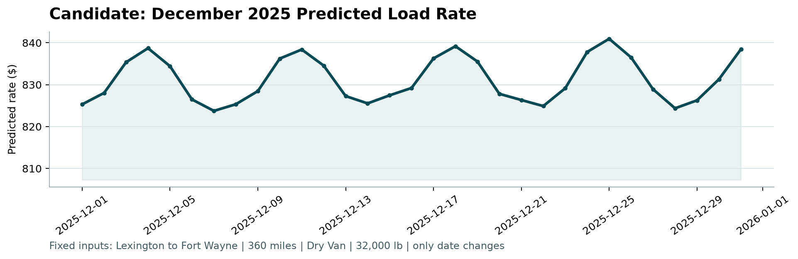

# Step 7 — Final evaluation and submission (Phase 3)

**Code:** [`src/test_evaluation.py`](../test_evaluation.py) · [`src/predict.py`](../predict.py)

```bash
poetry run python -m src.test_evaluation
poetry run python -m src.predict
poetry run python score.py --predictions validation_predictions.csv --december-predictions december-chart-inputs.csv
```

## 1. One-time October test

The final configuration (`src/final_model.py`) was frozen at the end of Step 6. Only then was October opened: every model trained on Jan–Sep and scored on the 4,853 October loads. The other models are reported for context only; nothing was chosen or changed afterwards.

| Model | MAPE | MAPE, plausible labels | WAPE | MAE | Median predicted / actual |
|---|---|---|---|---|---|
| Baseline | 10.93 | 8.10 | 9.72 | $231 | 0.993 |
| Ridge (Step 5) | 6.29 | 3.41 | 5.81 | $138 | 0.968 |
| LightGBM (Step 5) | 5.61 | 2.71 | 5.25 | $125 | 0.979 |
| **Final hybrid** | **4.54** | **1.56** | **4.04** | **$96** | **0.992** |

Reading the result:

- **Consistent with cross-validation** (4.15% ± 0.32). The final hybrid ranks first on every metric, and the ranking of all four models matches Steps 5–6.
- **Better than CV on plausible labels** (1.56% vs 1.99%). The higher full MAPE comes from the corrupted labels: 80 October loads (1.6%) have suspect labels with an average error of 182%, contributing about 3 points of MAPE on their own.
- **Unbiased:** median prediction 0.8% below the actual rate. Step 5's Ridge was 3.2% low, which is the drift fixed in Step 6.
- By segment, the final hybrid stays between 4.1% and 5.5% MAPE for every equipment type and distance band (`src/outputs/test/october_test_segments.csv`).

## 2. Final model and predictions

The final configuration is refit on **all of Jan–Oct** (677 suspect labels trimmed from training). The time trend is held at 31 October.

| Output | Content |
|---|---|
| `validation_predictions.csv` | 12,000 rows, `load_id,predicted_rate`, in the template's order |
| `december-chart-inputs.csv` | The provided file with `predicted_rate` filled; the six given columns are unchanged |
| `scorer_results/candidate_december.png` | Chart produced by `score.py` |

`score.py` output:

```
Validated 12,000 final predictions.
Validated 31 fixed December predictions.
Created chart: scorer_results/candidate_december.png
```

### Sanity checks on the validation predictions

| Check | Result |
|---|---|
| Range | $199 – $6,843, median $2,056 (training median $2,031) |
| Median rate per mile by equipment, predicted vs training | Dry Van 2.07 vs 2.05 · Flatbed 2.23 vs 2.22 · Reefer 2.31 vs 2.31 |
| Loads involving cities never seen in training (12%) | Median $2.18/mile vs $2.16 for other loads, at the same median distance (~950 mi) — no anomaly |
| November vs December median rate per mile | 2.163 vs 2.170 |

## 3. The December chart



- **Level:** $824–841 for Lexington → Fort Wayne, Dry Van, 360 miles. Historical Dry Van loads on this lane: median $807 (range $758–934). The prediction sits slightly above, consistent with the upward trend held at its October level.
- **Shape:** a weekly cycle of about ±$8 (~1%), peaking on Thursdays and lowest on Sundays/Mondays. It comes from the market index inputs for each December date, which follow the same weekly cycle seen in training (Step 4).
- **What it does not show:** holiday effects. No holiday period is in the training data, so the model treats 25 December like any other Thursday (it is the month's highest point, $841). In reality, freight around Christmas behaves differently. This is a known limitation, worth stating rather than hiding.

## Limitations

1. **Corrupted labels set an error floor** of ~2–3 MAPE points that no model can remove, if the scoring data contains them as the development data does.
2. **Trend held, not extrapolated:** if prices keep rising through Nov–Dec, predictions will run slightly low; if they fall back, holding the level limits the damage.
3. **No holiday knowledge:** Thanksgiving and Christmas are outside the training period.
4. **Feature availability:** `market_index` and `quote_signal` are assumed to be known when a quote is made; their exact meaning is not documented.
